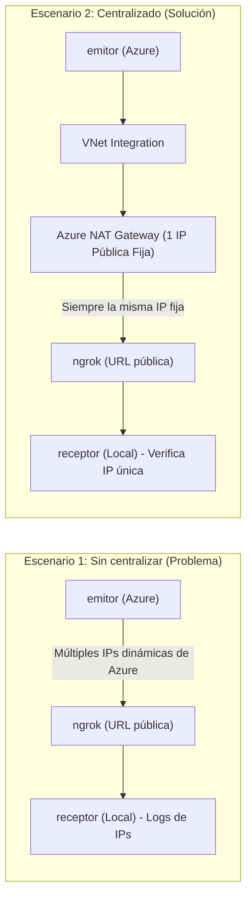

# Laboratorio: Centralización de IP de Salida en Azure (SASF → Omnihospital)

## 1. Contexto del Problema

La empresa **SASF** tiene varios servicios web desplegados en **Microsoft Azure** que consumen servicios externos expuestos por **Omnihospital** (a través de una URL pública).

**El problema actual:**
- Por la naturaleza de los servicios PaaS/cloud en Azure (por ejemplo, App Service, Functions, Container Apps, etc.), el tráfico saliente (*outbound / egress*) se origina desde un **pool dinámico de múltiples direcciones IP**.
- **Omnihospital** requiere restringir el acceso a sus endpoints para evitar que cualquier tercero pueda consumirlos, por lo que solicita poder **identificar y autorizar (IP Whitelisting)** el origen de las peticiones de SASF.
- Mantener una lista blanca con decenas de IPs dinámicas de Azure (que además pueden cambiar o compartirse con otros clientes de Azure en planes multi-tenant) es inseguro y difícil de mantener.

**El objetivo final:**
Lograr que todo el tráfico saliente desde los servicios de SASF en Azure hacia Omnihospital salga a través de **una única IP pública fija, dedicada e identificable** (por ejemplo, mediante un *NAT Gateway* u otra solución de gateway/egress centralizado).

---

## 2. Propósito del Laboratorio

Antes de tocar la infraestructura productiva de SASF, se construye un **laboratorio controlado** con los dos proyectos de este workspace para:
1. **Simular el escenario real** de comunicación entre SASF (consumidor) y Omnihospital (proveedor).
2. **Evidenciar el problema** observando en los logs las múltiples IPs de salida que emite Azure por defecto.
3. **Diseñar, implementar y validar** una solución de centralización de IP saliente en Azure, comprobando en los logs que todas las peticiones llegan desde una única IP fija.

---

## 3. Análisis de Roles y Arquitectura del Laboratorio

> **Observación importante sobre el planteamiento inicial:**
> En la descripción inicial se mencionó desplegar *el que consume* en ngrok y *el otro* en Azure, para que el de ngrok muestre logs de las IPs que recibe.
> **Los roles deben ir invertidos para que el experimento funcione como se espera:**
> - Quien **consume** (`emitor`, simulando a SASF) debe estar en **Azure**, porque es ahí donde queremos observar y luego centralizar las IPs de salida.
> - Quien **expone el endpoint y registra logs de las IPs entrantes** (`receptor`, simulando a Omnihospital) debe correr en **local expuesto con ngrok** (con una URL pública), para recibir el tráfico proveniente de Azure e inspeccionar desde qué IP(s) llega.

### Mapeo de Proyectos

| Proyecto en Workspace | Rol en el Lab | Simula a | Dónde se despliega | Función principal |
| :--- | :--- | :--- | :--- | :--- |
| `emitor` (`emitor/emitor/`) | **Consumidor / Cliente** | Servicios de **SASF** | **Microsoft Azure** | Realiza peticiones HTTP/REST/SOAP hacia la URL pública del `receptor`. |
| `receptor` (`receptor/`) | **Proveedor / Servidor** | Servicios de **Omnihospital** | **Local + ngrok** | Expone endpoints públicos y registra en logs la IP de origen y headers de cada petición recibida. |

*(Nota de estructura: ambos proyectos están inicializados con **Spring Boot 4.2.0** y **Java 17** usando Maven. El proyecto `emitor` tiene una carpeta anidada extra `emitor/emitor/` que conviene tener presente al compilar o desplegar).*

### Flujo de Prueba



---

## 4. Plan de Trabajo por Fases

### Fase 1: Armar la base local
- **`receptor`**:
  - Crear al menos un endpoint de prueba (ej. `GET /api/omni/ping` o `POST /api/omni/consulta`).
  - Registrar en logs de forma clara: timestamp, método, ruta, IP detectada (`X-Forwarded-For`, `X-Real-IP`, `RemoteAddr`) y headers relevantes.
  - Opcionalmente devolver la IP detectada en la respuesta JSON para facilitar la depuración.
- **`emitor`**:
  - Configurar una propiedad/variable de entorno con la URL destino (`TARGET_URL`) para poder cambiar fácilmente entre `localhost` y la URL de `ngrok` sin recompilar.
  - Crear un endpoint disparador (ej. `GET /api/sasf/test` o `GET /api/sasf/burst?count=10`) que haga una o varias llamadas al `receptor` y devuelva el resultado.
- **Validación local:** Probar `emitor` → `receptor` en `localhost` (en puertos distintos, ej. `8080` y `8081`).

### Fase 2: Despliegue híbrido (Azure + ngrok) y diagnóstico
1. Levantar `receptor` localmente y exponerlo a internet con **ngrok** (ej. `ngrok http 8081`).
2. Desplegar `emitor` en **Azure** (ej. Azure App Service o el mismo tipo de recurso que use SASF) apuntando `TARGET_URL` a la URL HTTPS generada por ngrok.
3. Disparar múltiples peticiones (e incluso escalar a 2 instancias o reiniciar el servicio) para observar en los logs de `receptor` y en el panel de ngrok (`http://127.0.0.1:4040`) las IPs públicas desde las que Azure envía las peticiones.

### Fase 3: Centralización de la IP de salida en Azure
1. Implementar la arquitectura de salida fija en Azure (recomendado: **VNet + Subnet delegada + Azure NAT Gateway + Public IP estática**).
2. Integrar `emitor` a la VNet y activar el enrutamiento de todo el tráfico saliente por la VNet (`Route All`).
3. Repetir las pruebas contra `receptor` (ngrok) y confirmar en los logs que **el 100% de las peticiones llegan desde la única IP pública fija** asignada al NAT Gateway.

---

## 5. Análisis Técnico y Puntos Críticos

### A. Detalle clave al usar `ngrok` para ver IPs
Cuando `receptor` corre detrás de **ngrok**, la conexión TCP local llega desde el agente de ngrok en tu misma máquina:
- `request.getRemoteAddr()` normalmente devolverá **`127.0.0.1`** (o `0:0:0:0:0:0:0:1`), **NO** la IP de Azure.
- La IP pública real de Azure vendrá en el header HTTP **`X-Forwarded-For`** (inyectado por ngrok).
- Por eso, `receptor` debe loggear explícitamente `X-Forwarded-For` (y todos los headers de forwarding) para que el laboratorio refleje la IP real de salida de Azure.

### B. Opciones de Arquitectura en Azure para Centralizar la IP de Salida

| Opción en Azure | Cómo funciona | Ventajas | Desventajas / Consideraciones |
| :--- | :--- | :--- | :--- |
| **1. VNet Integration + Azure NAT Gateway** *(Recomendada)* | Los servicios de Azure se conectan a una VNet/Subnet y todo el tráfico saliente (`Route All`) sale por un NAT Gateway con 1 IP Pública Estática. | - Estándar oficial de Azure para egress fijo.<br>- Escala muy bien (hasta 64,512 puertos SNAT por IP).<br>- Soporta múltiples servicios compartiendo la misma IP fija.<br>- Costo razonable y baja latencia. | - Requiere que los servicios soporten VNet Integration (en App Service requiere plan **Basic B1 o superior**; no funciona en Free/Shared). |
| **2. Azure Firewall (Hub-and-Spoke)** | Todo el tráfico saliente se enruta vía UDR (User Defined Route `0.0.0.0/0`) hacia un Azure Firewall con IP fija. | - Además de IP fija, permite filtrado por FQDN (ej. permitir salida solo hacia el dominio de Omnihospital), logging centralizado y reglas corporativas. | - Costo mensual significativamente mayor que NAT Gateway.<br>- Mayor complejidad de configuración. |
| **3. Gateway / Proxy de salida (API Management o Reverse Proxy)** | Los servicios llaman a un proxy/gateway central en Azure y este reenvía las peticiones a Omnihospital desde su IP fija. | - Permite agregar transformaciones, caching, rate-limiting o inyección de credenciales en un solo punto. | - Introduce un salto de aplicación extra (punto de fallo y latencia).<br>- APIM con IP fija y soporte VNet suele ser más costoso que un NAT Gateway.<br>- Obliga a cambiar las URLs destino en todos los servicios hacia el proxy. |

> **Conclusión arquitectónica:** Si el requerimiento principal es unificar las IPs de salida de varios servicios de SASF en una sola IP confiable y sin modificar el código de cada servicio, **VNet Integration + Azure NAT Gateway** es la opción más limpia, económica y escalable. Si además necesitan auditoría de red y control estricto de destinos, **Azure Firewall** es el siguiente paso.

### C. Configuración crítica en Azure App Service (si aplica)
Si el servicio en Azure es **App Service** o **Azure Functions**:
- No basta con conectar el App Service a la VNet; por defecto solo el tráfico hacia rangos privados (RFC 1918) pasa por la VNet.
- Es **obligatorio habilitar `Outbound internet traffic` / `vnetRouteAllEnabled = true`** (anteriormente `WEBSITE_VNET_ROUTE_ALL=1`) para que el tráfico hacia URLs públicas como ngrok u Omnihospital salga efectivamente por el NAT Gateway.

### D. Recomendación de Seguridad (Defensa en Profundidad)
El filtrado por IP (*IP Whitelisting*) solicitado por Omnihospital es una buena medida a nivel de red, pero **no debería ser el único mecanismo de autenticación**. En producción (especialmente en el sector salud), conviene complementarlo con:
- **HTTPS (TLS 1.2+)** obligatorio.
- Autenticación a nivel de aplicación (**API Key, OAuth 2.0 / JWT, o certificados cliente mTLS**).
- En escenarios de alta criticidad, una **VPN Site-to-Site** entre Azure y Omnihospital.

---

## 6. Conceptos Clave de Red en Azure (NAT, VNet y Subredes)

### ¿Qué es un NAT / Azure NAT Gateway?
**NAT** (*Network Address Translation* / Traducción de Direcciones de Red) funciona como el router de una casa u oficina:
- Internamente hay varios dispositivos o servicios, cada uno con su propia **IP privada** (`10.0.1.4`, `10.0.1.5`, etc.).
- Al salir hacia internet, el **Azure NAT Gateway** traduce todas esas IPs privadas a **una única IP pública fija** (SNAT).
- No requiere modificar el código ni cambiar la URL de destino en los web services: los servicios siguen llamando a Omnihospital normalmente, y Azure se encarga del enrutamiento a nivel de red.
- Es un recurso **solo de salida (*outbound*)**: permite que los servicios inicien conexiones hacia afuera y reciban respuestas, pero no abre acceso entrante desde internet hacia los servicios.

```text
[Web Service 1: 10.0.1.4] ──┐
[Web Service 2: 10.0.1.5] ──┼──► [ Azure NAT Gateway ] ──► IP Pública Fija (ej. 20.120.45.10) ──► Omnihospital
[Web Service 3: 10.0.1.6] ──┘
   (IPs privadas en subred)         (Traduce salida)              (Lo único que ve Omni)
```

### ¿Qué significa tener "múltiples IPs en una subred"?
- **VNet (Virtual Network):** Red privada corporativa en Azure con un rango amplio de IPs privadas (ej. `10.0.0.0/16`).
- **Subred (Subnet):** Subdivisión interna de la VNet (ej. `10.0.1.0/24`, ~251 IPs privadas utilizables).
- **Múltiples IPs privadas en la subred:** Cada servicio o instancia que se integra a la subred recibe su propia IP privada (`10.0.1.4`, `10.0.1.5`, etc.). Al asociar un único **NAT Gateway** a esa subred, **todos los servicios e instancias dentro de ella comparten automáticamente la misma IP pública fija** al salir a internet.
- **Múltiples IPs públicas en el NAT (opcional):** Un NAT Gateway soporta hasta 16 IPs públicas para cargas masivas (>64,000 conexiones simultáneas), pero para el escenario de lista blanca con Omnihospital, **1 sola IP pública fija** es lo ideal.

---

## 7. Preguntas Clave para Afinar el Plan

Antes de pasar a la implementación de la Fase 1 y Fase 3, conviene definir:
1. **¿Qué servicios específicos usa SASF actualmente en Azure?** (App Service, Azure Functions, Container Apps, AKS, VMs, o una mezcla de varios). Esto define el tipo de integración con VNet que probaremos en el laboratorio.
2. **¿Los servicios de Omnihospital son REST (JSON) o SOAP (XML)?** (En el `pom.xml` actual de ambos proyectos están incluidas tanto `spring-boot-starter-webmvc` como `spring-boot-starter-webservices`, aunque para probar el enrutamiento de IP a nivel de red basta con HTTP/REST).
3. **¿En qué suscripción/plan de Azure harás el laboratorio?** (Recordar que VNet Integration en App Service requiere al menos tier **Basic B1**).
